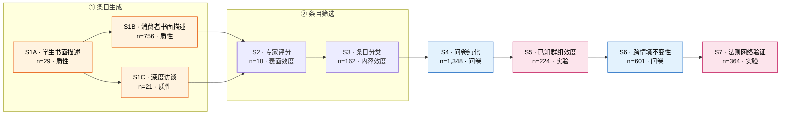

# 输出排版规范 / Output Format

## Markdown 报告结构（多研究论文）

```markdown
# 论文变量操作化提取报告

## 0. 文献信息
  标题 / 作者 / 期刊 / 年份 / DOI
  方法构成：本文含 N 个研究，方法分布为：实验 ×5、问卷 ×1、二手数据 ×1（多方法论文在此点明）

## 1. 研究地图 / Study Map（多研究论文必做）
  1.1 研究数量与列表（表格：编号 / 标签 / 方法 / n / 样本来源 / 主要目标）
  1.2 研究间关系（推进逻辑图或分条说明：谁建立主效应、谁做机制、谁做边界、谁做外部效度）
  1.3 方法分布说明（质性/问卷/实验/二手各自承担什么角色）

## 2. 核心构念的概念性定义（跨研究通用，先定义后操作化）

## 3. 变量总览表（一行一个变量；跨研究共用变量合并为一行）

## 4. 跨研究共用变量对照表（重要）
  | 变量 | 研究 | n | 题项数 | 量尺 | α | 来源 | 差异说明 |

## 5. 各研究详解（按研究分节）
  ### 5.1 Experiment 1（方法：实验）
    5.1.1 刺激材料清单（表格）
    5.1.2 变量（IV / DV / Mediator / Moderator / Control / 操纵检验）
    5.1.3 假设与验证结果
  ### 5.2 Study 2（方法：问卷）
    …
  ### 5.3 Study 3（方法：二手数据）
    …

## 6. 核心假设与验证结果汇总表（跨研究）
  | 研究 | 假设 | 内容（中英） | IV→DV（含中介/调节） | 检验方法 | 统计量 | p | 效应量 | 是否支持 |

## 7. 信息缺口清单 / Missing Information

## 8. 附：量表出处参考文献（APA）
```

单研究论文可省略 1、4、6 三节。

**但单研究论文不能省「样本与数据收集」**：放在第 5 节开头，先讲样本怎么来的，再讲变量。至少要给：抽样框与抽样方式、每一波的发出/回收/可用数、响应率、**n 的构成（各波相加须等于总 n）**、样本特征、数据收集时间、测量时点（横断面/纵贯）。

## 元分析论文的报告结构（替换 2–6 节）

元分析的提取单元是效应量与调节变量编码，不是被试层面的变量。结构改为：

```markdown
## 0. 文献信息（含：纳入论文数 / 研究数 / 效应量数 / 累计参与者数）

## 1. 分析地图（按「分析单元」而非「研究」分节）
  1.1 检索与纳入流程（四步检索、数据库、检索词、纳入排除标准、排除篇数）
  1.2 各分析单元（主效应 / 与折扣对比 / 与其他 CSR 工具对比 / 调节效应全模型 / 亚组 / 双变量合成）
  1.3 方法说明（效应量指标与转换、层级模型设定、软件）

## 2. 效应量汇总表（EffectSizes）
  | 对比基准 | 结果变量 | 模型 | k(研究/效应量) | 总 N | d | SE/CI | p | CLES | I² | Fail-safe N |

## 3. 结果变量（效应量）的概念性定义与操作化
  如「态度响应 = 对焦点品牌及其 CM 活动的总体有利/不利判断；行为响应 = 与 CM 关联品牌的（意向）购买」

## 4. 调节变量总览表（一行一个调节变量）
  | 变量 | 所属支柱 | 编码规则 | 取值来源 | 编码水平 | k(研究数) |

## 5. 概念支柱层级树（parent_theme → 调节变量）

## 6. 调节变量结果汇总（态度 / 行为双列 + 组间差异 Δb + 模型标注）
  | 调节变量 | 支柱 | b(态度) | β(态度) | b(行为) | β(行为) | Δb | 模型 | 是否支持 |

## 7. 发表偏倚与敏感性分析

## 8. 编码方案与编码信度（κ / ICC + 五类取值来源分别说明）

## 9. 信息缺口清单
```

**三条硬规则**：
1. 每个效应量必须标 `comparison`（对比基准）与 `model`（无条件/全模型/亚组/双变量），否则同一 d 值会被误读。
2. 调节变量结论必须区分**有 no-CM 对照组**与**无对照组的纯调节研究**——后者无法估计主效应，其结果与前者相反是常态（不是矛盾，要如实并列）。
3. 调节变量的「操作化」写**编码规则 + 取值来源**（文献编码 / 外部二手指标 / 作者另做调查 / 专家评定 / 自动文本分析），不要去找题项与 α。

## 跨研究共用变量：合并规则（重要）

同一变量在多个研究出现时：

1. **概念性定义、题项、响应量尺只写一次**，放在「核心构念」或首次出现的研究小节里；后续研究写「同研究 X，见 5.1.2」，不再重复题项。
2. **信度、来源、样本量、改编情况按研究列出**——用「跨研究对照表」呈现差异，例如：

| 变量 | 研究 | n | 题项数 | 响应量尺 | α | 来源 |
|---|---|---|---|---|---|---|
| 决策容易度 / Decision Ease | E1 | 225 | 2 | 7 点（1=Not at all, 7=Very） | .89 | 原文未提供 |
| | E2 | 200 | 2 | 同上 | .88 | 原文未提供 |
| | E3 | 117 | 2 | 同上 | .92 | 原文未提供 |
| | E4 | 340 | 2 | 同上 | .84 | 原文未提供 |
| | E5 | 150 | 2 | 同上 | .93 | 原文未提供 |
| | E6B | 103 | 2 | 同上 | .87 | 原文未提供 |

3. 若某研究中该量表被**改编**（题项数变化、量尺变化），则在该研究小节内单独说明差异，并仍写入对照表。

### 跨研究「操作化」对照（二手数据与多方法论文必做）

多方法论文里，同一构念在不同研究中往往**换了完全不同的操作化**（国家档案指标 vs 州级指标 vs 实验操纵）。此时对照表的核心列不是 α，而是**操作化与来源**，例如：

| 构念 | 研究 | 样本 | 操作化 | 数据来源 | 方向编码 |
|---|---|---|---|---|---|
| 宗教性 / Religiosity | S1 | 140 国 | 各国回答「宗教是否重要」的百分比 | Gallup (Crabtree & Pelham, 2009)，143 国，2006–2008 | 高分 = 更宗教 |
| | S2a | 50 州 | 1=非宗教 / 2=中等 / 3=高度宗教，取州均值 | Gallup，348,306 人访谈，2012 | 高分 = 更宗教 |
| | S2b | 50 州 × 10 年 | 同上，取 2008 年基线 | Gallup 年度民调 2008–2016 | 高分 = 更宗教 |
| | S3a/3b | 91 / 143 人 | **实验操纵**：ServiceOne 企业核心价值观 | 改编自企业使命陈述 | 高宗教 vs 控制 |

写法要点：
- **合成变量也要进对照表**，一格写清「由 N 个指标合成，标准化后取均值」，具体指标留给 `Indicators` 表 / 正文
- 方向编码列不能省——同一个构念在不同研究里可能反向（如「女性能动性」高分 = 能动性**低**）
- 实验操纵的那一行要标明是操纵而非测量，避免与测量行混淆

## 研究间关系的写法

用一句话链条 + 每条展开，例如：

> **推进逻辑**：E1 建立主效应与中介 → E2 通过操纵中介做调节验证 → E3 换刺激（未知品牌）排除替代解释 → E4 检验边界条件（单一品牌无效） → E5 检验习惯化与再注意 → E6A/B 在真实场景中验证下游结果（委托率与决策容易度）。

常见角色标签（可直接用）：
- 建立主效应 / 建立效应存在性
- 机制检验（中介 measurement-of-mediation）
- 机制检验（调节 moderation-of-process / 操纵中介）
- 排除替代解释
- 稳健性 / 复制（exact replication / conceptual replication）
- 边界条件 / 调节变量
- 外部效度 / 现实情境
- 下游结果 / 管理启示
- 预测试（pretest）/ 后测（post-test）
- 条目生成 / 条目筛选 / 量表纯化 / 效度验证 / 应用示范（量表开发论文）
- 测量工具开发 / 测量工具验证 / 测量工具应用（计算测量论文）
- 建立理论模型 / 推导命题 / 比较静态 / 数值算例（分析模型论文）

### 研究地图可视化（≥3 个研究时必做）

文字链条之外，**再给一张 Mermaid 流程图**，让读者一眼看到推进结构。写在 1.2 节，紧接文字链条之后。

规范：

- 用 `flowchart LR`，节点格式 `S1["S1 · 质性描述<br/>n=29<br/>条目生成"]`——编号 + 方法/任务 + n + 该研究的角色
- 节点文字里的换行用 `<br/>`，不要用真实换行
- 用实线箭头 `-->` 表示推进，用 `-.->` 表示辅助/前置关系（如 pretest、formative 访谈）
- 方法不同时**用颜色区分**：实验、问卷、质性、二手数据各一色（在 `classDef` 中定义）
- 节点数超过 9 个时按阶段分组（`subgraph`），例如量表开发论文分「条目生成 / 条目筛选 / 纯化与验证 / 应用」

模板：

````markdown

````

### 节点悬停 tooltip（主要发现）

每个节点挂一条 `click` tooltip，鼠标悬停即显示该研究的主要发现，避免图与正文来回对照：

```
    click S1 href "#" "主要发现：religiosity b=8.47, SE=1.99, p<.001；三条间接效应均显著；总效应解释 37%"
```

规则：

- tooltip 文本取自 `key_finding`，缺失时用 `main_purpose`，**控制在 140 字内**（脚本会自动截断）
- 文本里**禁止出现英文双引号**——会把 click 语句截断导致整图渲染失败；用中文引号「」代替
- tooltip 是**增强层**，不是信息载体：GitHub 等部分渲染器会忽略 `click`。因此 1.1 节的研究地图表格仍须完整给出「主要发现」，不能只靠 tooltip
- 括号 `()` 在引号包裹的 tooltip 内安全，但若渲染器报错，优先删 `click` 行而不是删正文表格

### 节点文字规则

- 节点行序：**第一行 = 编号 · 角色**（这个研究在论文里干什么）→ 第二行 = `n=xxx · 方法` → 第三行 = 原文标签。读图的人第一眼要的是推进逻辑，不是原文标题
- 节点文字里**不要出现英文双引号**；括号在 `["..."]` 引号包裹内安全
- 用 `·` 或 `<br/>` 分隔，不要用真实换行

### 自动生成（推荐流程）

1. 先按 `references/excel-codebook.md` 写好 JSON
2. 运行 `python3 scripts/export_codebook.py codebook.json out.xlsx`——脚本会
   - 在 Studies 表末列写入 `mermaid_node`（每段一个节点定义，可直接复制拼接）
   - 输出同名 `out.mmd`（完整源码）
   - 把源码打印到终端
3. 把打印出的源码粘进报告 1.2 节，**再用 `mermaid_edges` / `mermaid_groups` 手工校正推进顺序**

顶层可选键（不提供时脚本按 studies 顺序自动串联）：

```json
"mermaid_groups": {"① 条目生成": ["S1A","S1B"], "② 条目筛选": ["S2","S3"]},
"mermaid_edges": ["S1A --> S1B", "S2 --> S3 --> S4", "S6pre -.-> S6"]
```

**边几乎总是要手工校正**——自动串联会把 pretest 节点排进主链条（如 `S1C --> S6pre --> S2`）。前置/辅助关系用虚线 `-.->`。

## 假设与结果模块

即使论文没有显式编号（H1、H2），也要抽取其研究预期（"we predicted that…"），并标注「原文未编号」。

每条假设需给出：

| 字段 | 要求 |
|---|---|
| 假设编号 | H1 / H2a / Predicted-1（未编号时） |
| 内容 | 原文预测句（引用块）+ 中文翻译 |
| 涉及变量 | IV → DV，含中介 / 调节 |
| 检验方法 | ANOVA / regression / PROCESS (Hayes) / chi-square / SEM / bootstrap CI 等 |
| 统计量 | 如 `F(2, 222) = 5.97`、`t(222) = 3.34`、`χ²(1, N=100) = 4.24` |
| p 值 | 如 `p = .003`；仅报告 `p > .05` 时照抄 |
| 效应量 | `d = .46`、`η² = .051`、`φ = .21`、bootstrap 95% CI 等 |
| 方向 | 正向 / 负向 / 组间差异方向 |
| 是否支持 | **支持 / 部分支持 / 未支持 / 反向** |

**禁止**把作者未检验的关系写成已检验；**禁止**把不显著结果写成支持。

**分析模型的命题用 `Proposition-N`，不用 `H1`**：`test_type` 写 `Derivation`，`supported` 写 `Derived`（命题是被**证明**的，不是被**观察**的）。实证部分是否与命题一致，写进 `note`——一致性佐证不等于检验，别写成"实证支持"。

**两层结果必须分开记**：论文常同时给「零阶相关」与「结构模型路径」，二者结论可能不一致（相关显著、路径不显著）。处理规则：

1. **以结构模型为准**判「是否支持」；
2. 零阶相关写入 `zero_order_r`，并在 `note` 说明为何两者不一致（作者通常会给解释）；
3. **禁止**只看相关就判「支持」——那会把作者专门讨论的反例抹掉，也会让读者以为结论比实际更强。

## 计算测量表（计算测量类必做）

先给「模型怎么造」的表，再给「模型准不准」的表，最后才是构念层指标。字段与红线见
`computational-measurement.md`。最小要求：训练数据与标注方式、**负例怎么构造**、
train/val/holdout 的规模与划分单位、基座与超参、AUC（不能只报 accuracy）、
**与单个人类标注者的对照**、与传统方法的基线比较。

## 刺激材料表（实验类必做）

每个研究先给材料表（字段见 `references/experiment.md` 第 0 节），再给变量。材料中出现的原文（指令语、vignette、词表、选项清单）逐字摘录并给中文对照。

## 主题层级树（质性论文必做）

质性论文的"变量"是主题，数据结构是树。变量总览表之前**先给一张缩进的层级树**，让读者一眼看到构念结构：

```markdown
- **品牌社群 / Brand Community**（核心构念）
  - **社群意识 / Consciousness of Kind**（传统标记 1）
    - 合法性 / Legitimacy
    - 对立品牌忠诚 / Oppositional Brand Loyalty
  - **仪式与传统 / Rituals and Traditions**（传统标记 2）
    - 打招呼仪式 / Greeting Rituals
    - 庆祝品牌历史 / Celebrating the History of the Brand
    - 分享品牌故事 / Sharing Brand Stories
      - 奥德赛故事 / Odyssey story
      - 「救了我一命」故事 / Saved-my-life story
      - 「魔洞」故事 / Magic cavern story
  - **道德责任 / Moral Responsibility**（传统标记 3）
    - 吸纳与保留成员 / Integrating and Retaining Members
    - 协助使用品牌 / Assisting in the Use of the Brand
```

规则：

- **先树后表**：树是这类论文的"数据结构图"（相当于量化论文的 Table 1），不能省
- Excel 里用 `parent_theme` + `theme_level` 两列表达同一棵树，`parent_theme` 必须与上级行名称完全一致
- 每个主题至少给一条**逐字代表性引语** + 受访者标识（如 `George, carpenter, 38`）
- 一阶概念用受访者原话命名（in vivo code），二阶主题用研究者概念命名——区分清楚，别混

## 田野点表（民族志必做）

田野研究不先讲变量，先讲**在哪里收集的数据**：地点 → 类型 → 收集方式 → 规模 → 研究者在场方式。见 `references/qualitative.md` §8.2。

## 排版规则

1. **层级清晰**：一级标题分大块，二级标题为研究，三级标题为材料/变量/假设。
2. **字段名加粗**，便于扫读。
3. **题项与材料用编号列表或表格**，逐字照抄 + 中英对照。
4. **原文引用用 `>` 引用块**，紧跟中文翻译。
5. **表格用于汇总与对照**，长题项放列表。
6. **指标代码、变量字段用行内代码**包裹（如 `NY.GDP.MKTP.CD`）。
7. 对话中输出**精简版**（研究地图 + 总览表 + 核心题项 + 假设汇总 + 缺口），完整版写入文件。

## 质量自检清单（输出前核对）

- [ ] 是否逐个研究判定方法（而非整篇只判一次）？
- [ ] 多研究论文是否有研究地图（数量、目标、研究间关系）？
- [ ] ≥3 个研究时是否给了 Mermaid 研究地图，且方法用颜色区分？
- [ ] 研究地图节点是否挂了悬停 tooltip（主要发现），且 1.1 表格里仍有完整的「主要发现」作降级？
- [ ] 边的推进顺序是否手工校正过（pretest 用虚线，未排进主链条）？
- [ ] 量表开发论文是否按开发阶段建行（生成/筛选/纯化/验证/应用）并记录条目数变化？
- [ ] 只报 CR / AVE 未报 α 时，是否照实记录并标注缺失，而非留空或补一个 α？
- [ ] 跨研究共用变量是否合并呈现 + 给出各研究 α 对照表？
- [ ] 实验类是否给了刺激材料清单，且原文逐字？
- [ ] 是否抽取了假设与验证结果，并标注支持与否？
- [ ] 变量角色是否覆盖 IV / DV / Mediator / Moderator / Control？
- [ ] 是否检查了 appendix、web appendix、Table、脚注？
- [ ] 题项是否逐字、有无中英对照？
- [ ] 信度是否为具体指标 + 数值？
- [ ] 量表来源是否完整 APA + 区分 Adopted / Adapted？
- [ ] 质性研究是否给了编码方案与编码者间信度？
- [ ] 质性论文是否画了主题层级树，Excel 的 `parent_theme` 是否无断链？
- [ ] 民族志是否列了田野点清单，`n`（人数）与 `data_volume`（小时/页数）是否分开填？
- [ ] 是否记录了研究者立场（参与/非参与、局内身份）与化名声明？
- [ ] 无假设的论文是否改用 `Objective-N` 记录研究目标，并用 `Observed` 而非 `Supported`？
- [ ] 文献综述型研究是否给了检索式、纳入文献数/段落数、编码程序、饱和判据？
- [ ] 二手数据是否精确到库 + 指标代码 + 年份？
- [ ] 元分析是否被正确识别（而非误判为文献综述）？是否产出 EffectSizes 表？
- [ ] 元分析是否分别记录了论文数 / 研究数 / 效应量数 / 累计参与者数？
- [ ] 每个效应量是否标了 `comparison`（对比基准）与 `model`（无条件/全模型/亚组/双变量）？
- [ ] 调节变量是否写了编码规则与取值来源（五类）？反向编码是否标明？
- [ ] 是否记录了发表偏倚检验（未发表文献占比 / fail-safe N / 漏斗图 / 回归法）？
- [ ] 异质性 I² 是否记录，并说明数据结构（效应量嵌套于研究）？
- [ ] 有对照组与无对照组两类子样本的结果是否分开呈现？
- [ ] 多指标合成变量是否只占一行，指标进了 Indicators 表，且标了反向计分？
- [ ] 纵贯/嵌套数据是否区分了聚类数与观测数，并给了 level 1 / level 2 单位？
- [ ] 外部补充材料 URL 是否尝试抓取过？抓不到的是否在缺口清单单列？
- [ ] 有无编造？缺失是否写「原文未提供」/ Excel 写 `NA`？
- [ ] 是否同时产出 Markdown 报告 + Excel 变量表？

## 禁止事项

- ❌ 编造题项、信度数值、APA 出处、指标代码、统计结果
- ❌ 用「量表较为成熟」「信度良好」替代具体数值
- ❌ 同一量表在 N 个研究里重复描述 N 遍
- ❌ 把作者未做的分析或未下的结论写成文章事实
- ❌ 替作者消解原文内部的不一致（应并列标注）
